 

**I build small web things, and host most of what I use myself.**

<a href="https://tool.avenpa.com">tool.avenpa.com</a> &nbsp;·&nbsp;
<a href="https://www.avenpa.com">www.avenpa.com</a> &nbsp;·&nbsp;
<a href="mailto:contact@avenpa.com">contact@avenpa.com</a>

 

## Featured

### [ToolAvenpa](https://tool.avenpa.com)

30 browser tools for photos, dates and money. No sign-up, and your files are never uploaded to a server.

`Astro` `TypeScript` `Cloudflare Workers` &nbsp;·&nbsp; [source](https://github.com/avenpa/tool-avenpa)

 

## About

|   |   |
|---|---|
| **Focus** | web, linux, automation |
| **Interested in** | self-hosting, security, minimal interfaces |
| **Style** | black &amp; white, mostly |

 

## Stack

`Python` `JavaScript` `TypeScript` `Astro` `Node.js` `Linux` `SQLite` `Cloudflare` `systemd`

 

## Contact

[contact@avenpa.com](mailto:contact@avenpa.com)

 

avenpa

